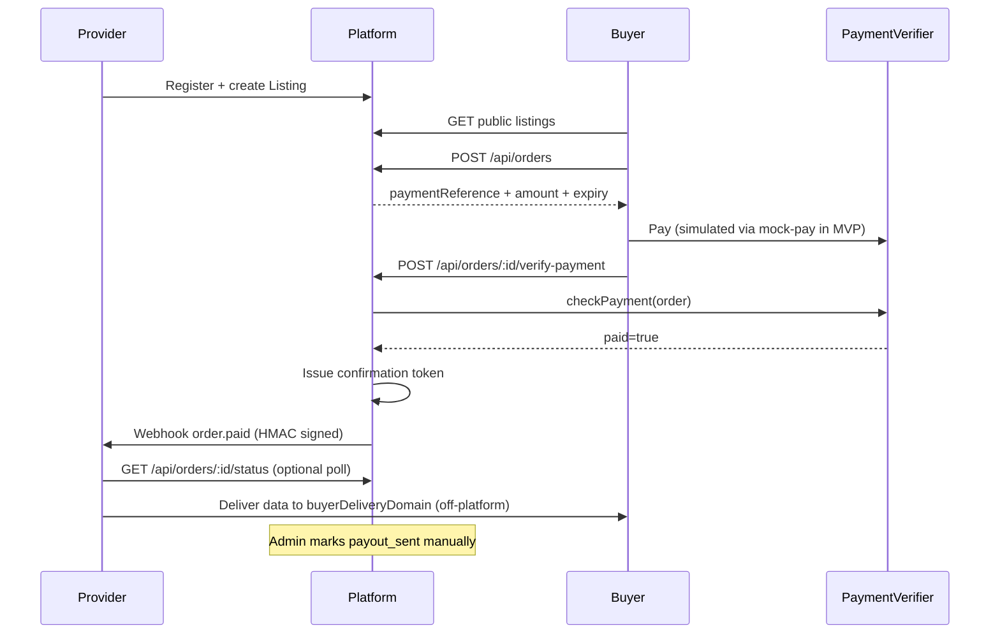

# Architecture

## Compliance disclaimer

> **This is a demo/MVP.** It does not custody real user funds, does not perform KYC/AML, and does not automate payouts. Before handling real money movement between users, this project would require: (a) legal review of money-transmission/payment-facilitator regulations in the relevant jurisdictions, (b) KYC/AML procedures, (c) a licensed payment processor or custodial partner instead of the mock verifier, and (d) a security audit. The `PaymentVerifier` interface is intentionally pluggable so a compliant, audited payment backend can be substituted later without changing the rest of the system.

## Core flow



## Folder structure

```
src/
  app.ts                 Express app wiring + security middleware
  server.ts              Process entrypoint
  config/                env + logger
  db/prisma.ts           Prisma client singleton
  middleware/            auth, validate, errors, requestId
  routes/                HTTP route modules
  schemas/               Zod request schemas
  services/              Business logic (auth, listings, orders, webhooks, confirmation)
  payments/              PaymentVerifier interface + MockPaymentVerifier
  utils/                 HMAC, IDs, AppError
prisma/
  schema.prisma          Data model (SQLite now; Postgres-ready types)
  seed.ts                Demo data
tests/                   Jest unit + integration tests
docs/                    OpenAPI + webhook contract
```

## PaymentVerifier plugin

```ts
interface PaymentVerifier {
  checkPayment(order: Order): Promise<{ paid: boolean; confirmedAmount?: string }>;
}
```

- **MockPaymentVerifier** (default): in-memory marks via `POST /api/dev/mock-pay/:orderId` when `NODE_ENV !== 'production'`.
- Swap via `setPaymentVerifier()` without changing order/webhook code.
- **Not implemented (stretch):** TestnetPaymentVerifier — intentionally omitted for MVP time; would query a testnet explorer for `paymentReference` matching amount and must never be used with real funds.

## Assumptions

1. Single Node process monolith is sufficient for MVP (no queues/microservices).
2. Buyers must register with role `BUYER` (lightweight API-key anonymous flow deferred).
3. `providerWebhookSecret` is stored in **plaintext** in SQLite for MVP so HMAC can be computed; production should encrypt at rest (KMS) or store a hash only if an alternate signing scheme is used. Secret is returned **once** on listing create and never on public/list endpoints.
4. Confirmation tokens are JWTs signed with `JWT_SECRET` (7-day expiry).
5. Outgoing webhooks retry with exponential backoff up to `WEBHOOK_MAX_ATTEMPTS`, each attempt timed out at `WEBHOOK_TIMEOUT_MS`, and every attempt is written to `WebhookDeliveryLog`.
6. Payouts are **manual**: admin `PATCH /api/admin/orders/:id/payout` moves `paid` → `payout_sent`. No fund movement occurs.
7. Prisma schema avoids SQLite-only features so `provider` can later switch to PostgreSQL by changing `datasource` + `DATABASE_URL`.
9. Password hashing uses **bcryptjs** (pure JS) instead of native `bcrypt` for simpler installs on Node 20+/24; API and cost factor semantics match bcrypt.

## Security notes (MVP)

- bcryptjs (compatible bcrypt API, cost ≥ 10), JWT Bearer auth, helmet, CORS allowlist, rate limits on auth + orders.
- Consistent error shape: `{ error: { code, message, details? } }`.
- Public catalog strips `payoutAddress` and webhook secrets.
