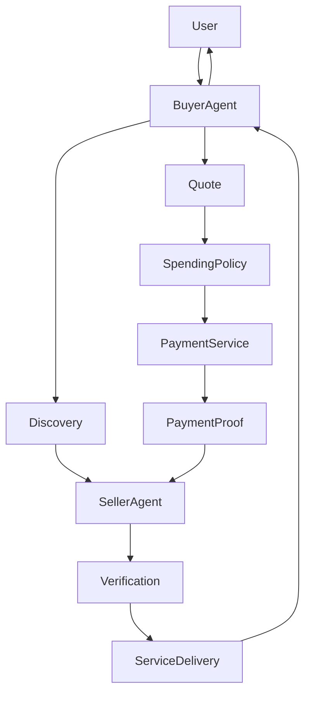

# Architecture (v2)

## Compliance disclaimer

> **This is a demo/MVP.** It does not custody real user funds, does not perform KYC/AML, and does not automate real payouts. Before handling real money movement between users, this project would require: (a) legal review of money-transmission/payment-facilitator regulations in the relevant jurisdictions, (b) KYC/AML procedures, (c) a licensed payment processor or custodial partner instead of the mock verifier, and (d) a security audit.

## Product story

```text
A Buyer Agent can discover another Agent, choose its service, agree on a price,
follow its spending rules, make a simulated USDC payment, generate payment proof,
and receive the service — with no human manually coordinating the transaction.
```

## Autonomous commerce flow



## Two demo layers

1. **Autonomous Agent Demo** (`POST /api/demo/autonomous`) — user-facing one-click commerce.
2. **Architecture Walkthrough** — existing 11-phase Provider/Buyer/Order/webhook/admin flow (unchanged).

## Modules (additive on MVP)

| Module | Path | Role |
|---|---|---|
| Agents | `src/services/agentService.ts` | Discovery + public agent profiles |
| Decision engine | `src/services/decisionEngine.ts` | Deterministic cheapest-provider selection |
| Spending policy | `src/services/spendingPolicy.ts` | Max tx / daily / token checks |
| Quotes | `src/services/quoteService.ts` | Quote + simple negotiation |
| Mock wallet | `src/payments/MockWallet.ts` | Simulated USDC balances |
| Payment service | `src/services/paymentService.ts` | Intent → mock pay → proof |
| Payment proof | `src/services/paymentProofService.ts` | JWT agent payment proof |
| Delivery | `src/services/deliveryService.ts` | Mock weather/crypto/translation |
| Orchestrator | `src/services/autonomousCommerce.ts` | Timeline + full autonomous run |

Legacy MVP modules (orders, listings, webhooks, MockPaymentVerifier) remain for the architecture walkthrough.

## Data model (Prisma / SQLite)

**Existing:** `User`, `Listing` (+ optional `agentId`, `capability`), `Order`, `WebhookDeliveryLog`

**New (v2):** `Agent`, `Quote`, `AgentPayment`, `ServiceDelivery`

## Assumptions

1. Default demo is deterministic (Weather Agent A at 0.10 USDC).
2. No external LLM — `AgentDecisionEngine` is rule-based.
3. Wallets never store private keys; tx hashes are `0xmock_*`.
4. Admin payout remains available but is not the v2 centerpiece.

## Security (demo)

- Secrets never exposed on public agent/offer endpoints
- Duplicate payment / duplicate delivery rejected
- Proof validates amount, currency, receiver, tx hash
- Spending policy enforced before mock transfer
